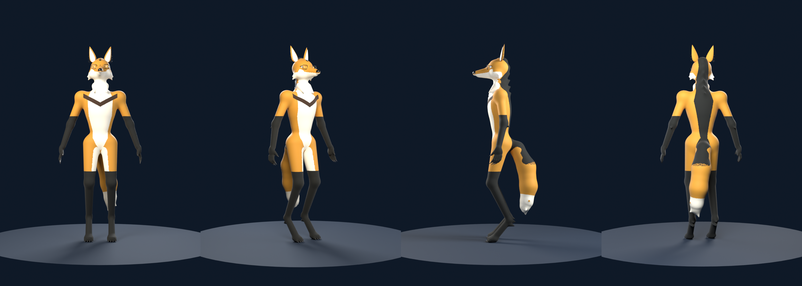

# Vince — 3D model (wersja robocza v1)

Stylizowany model bazowy Vincenta „Vince” Cancrosy (wilk grzywiasty, 193 cm, digitigradalny), zrobiony w Blenderze 5.3 w całości skryptem.
Opis i kolory pochodzą z `vince.html` oraz arkusza referencyjnego od Asha w repozytorium `V-Cancrosa/V-Cancrosa`.



## Pliki

| Plik | Co to jest |
|---|---|
| `vince.blend` | Scena Blendera: model, materiały, światła, kamery |
| `vince.glb` | Sam model (ciało, oczy, uszy, pazury, okulary, kolczyki) do podglądu albo importu w innych programach |
| `vince.py` | Skrypt, który buduje cały model od zera i renderuje widoki |
| `renders/` | Rendery: przód, 3/4, bok, tył, głowa i zestawienie `sheet.png` |

## Jak to jest zbudowane

- Ciało to jedna gładka bryła: około 100 prostych kształtów (stożki o zaokrąglonych końcach, elipsoidy) zlanych w jedno pole odległości (SDF), zamienione w siatkę algorytmem marching cubes.
- Kolory futra są przypisane do ścianek według stref z arkusza. Każda strefa ma osobny materiał:
  - `Fur_CopperGold` `#C8892B`
  - `Fur_Cream` `#ECE3CF`
  - `Fur_JetBlack` `#1A1A16`
  - `Fur_DarkBrown` (ciemne „V” na piersi)
- Osobne obiekty:
  - oczy (bursztyn `#D99A2B`),
  - uszy z kremowym środkiem,
  - pazury,
  - stalowo-grafitowe okulary z geometrycznymi szkłami,
  - po trzy matowoczarne kółka w każdym uchu.
- Proporcje, pozycje i kolory to liczby w `vince.py`. Żeby coś zmienić, edytujesz skrypt i budujesz model od nowa (ok. 30–80 s z renderem).

## Uruchomienie

```bash
uv venv bvenv && uv pip install --python bvenv/bin/python bpy scikit-image pillow   # bpy 5.x wymaga Pythona 3.13
bvenv/bin/python vince.py --samples 64                      # wszystkie widoki
bvenv/bin/python vince.py --samples 24 --views front,head   # szybki podgląd
```

Renderuje Cycles na CPU, bo w trybie bez okna EEVEE wymaga GPU.

## Ograniczenia v1

- Gładka powierzchnia bez sierści. Kępki futra są tylko w bryle.
- Gęsta siatka (ok. 380 tys. trójkątów) bez szkieletu. Nadaje się do renderu i druku 3D. Do VRChata albo gry trzeba ją uprościć (retopologia) i dodać szkielet.
- Drobne błędy: plamka na czubku głowy, poszarpana granica koloru u nasady ogona, kółka w uszach odstają od krawędzi.
- Bez ubrania. Garderoba z `vince.html` (bluza Dual Path, spodnie krojone pod staw skokowy, buty z odkrytym przodem) czeka na następną wersję.
